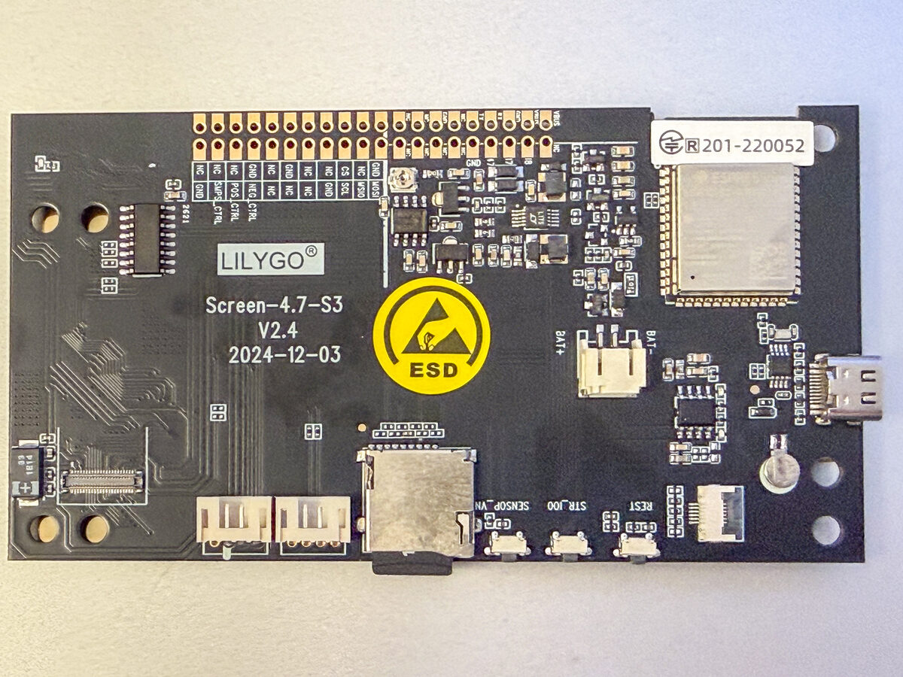

# LilyGo T5 4.7" e-paper sketches

Arduino sketches for the **LilyGo T5-4.7 (ESP32-S3)**: ED047TC1 panel, 960x540,
16 gray levels, 74HC595 control shift register.

Six independent folders; two display libraries:

| Folder | Library | Contents |
|---|---|---|
| [LilyGo/](LilyGo/) | [LilyGo-EPD47](https://github.com/Xinyuan-LilyGO/LilyGo-EPD47) | Vendor examples: `demo`, `button`, `drawExample`, `drawImages`, `grayscale_test`, `screen_repair`, `wifi_sync` |
| [OWM-Weather/](OWM-Weather/) | LilyGo-EPD47 | Port of David Bird's OpenWeatherMap display (see [OWM-Weather](#owm-weather)) |
| [OpenMeteo-Weather/](OpenMeteo-Weather/) | LilyGo-EPD47 | Open-Meteo weather dashboard, no API key (see [OpenMeteo-Weather](#openmeteo-weather)) |
| [News/](News/) | LilyGo-EPD47 | NewsAPI top headlines (needs a free API key) |
| [Quotables/](Quotables/) | LilyGo-EPD47 | Random quote, no API key |
| [FastEPD/](FastEPD/) | [bitbank2/FastEPD](https://github.com/bitbank2/FastEPD) | `animated_smiles`, `antialias_font`, `gif_player`, `grayscale_test`, `macpaint_hello`, `microSD`, `show_jpeg`, plus a patch that adds this board to FastEPD (see [FastEPD/README.md](FastEPD/README.md)) |

> **Not in this repository:** `OWM-Weather/` (port of David Bird's OpenWeatherMap sketch) is kept out because the upstream code has no license ("all rights reserved"). The section below describes the local port only.

> **Licenses:** the vendor examples in `LilyGo/` are copied from [LilyGo-EPD47](https://github.com/Xinyuan-LilyGO/LilyGo-EPD47), which is GPL-3.0; the license text is in [LilyGo/LICENSE](LilyGo/LICENSE). The other folders have no license of their own yet. Lucide icons in `OpenMeteo-Weather/icons/` are ISC (see `LICENSE-lucide.txt`).

## The board

Back of the board (Screen-4.7-S3 V2.4, 2024-12-03), USB-C on the right. Along the bottom edge, left to right: the two 4-pin JST sockets (P4 and P5), the TF card slot, then the buttons `SENSOR_VN`, `STR_IO0` (BOOT) and `REST` (reset). The 2-pin battery socket is above the USB-C port.

**Board revision:** this is a **V2.4** board. The photos on LilyGo's [product page](https://lilygo.cc/en-us/products/t5-4-7-inch-e-paper-v2-3) and [wiki](https://wiki.lilygo.cc/products/t5-series/t5-e-paper/) do not match it. The only documentation that matches is the [V2.4 schematic](https://github.com/Xinyuan-LilyGO/LilyGo-EPD47/blob/esp32s3/schematic/Screen-4.7-S3-V2.4%2024-12-03.pdf) (also in the library's `schematic/` folder). Use it, not the wiki, for pinouts. Compared with the V2.3 schematic, the GPIO net names are the same; the differences are components (3V3 regulator, an added 8-pin touch FPC connector, series resistors on the P4 socket).

## Arduino IDE settings

- Board: **ESP32S3 Dev Module**
- PSRAM: **OPI PSRAM** (required; the vendor sketches `#error` without it)
- Flash size: 16MB
- USB CDC On Boot: Enabled
- Partition scheme: `16M Flash (3M APP/9.9MB FATFS)`, except `wifi_sync`, which ships its own `partitions_custom.csv`

## Libraries

Install into `~/Src/Arduino/libraries/`:

- LilyGo-EPD47 (provides `epd_driver.h`, `firasans.h`, `utilities.h`, `libjpeg/`) for everything under `LilyGo/`
- FastEPD **2.2.0** (stock, no patch needed) for everything under `FastEPD/`
- Button2, SensorLib (v0.19+, for `demo`)

## Quick start (FastEPD)

1. Install FastEPD 2.2.0. No patch is needed: the sketches include `FastEPD/lilygo_t5_47_s3.h`, which defines this board (technique from [VulnCast](https://github.com/vulnersCom/VulnCast)).
2. Open `FastEPD/animated_smiles/animated_smiles.ino`, select the board settings above, upload.

The old `lilygo-t5-47-s3.patch` is optional now. Details and gotchas: [FastEPD/README.md](FastEPD/README.md).

## Quick start (LilyGo sketches)

1. For `demo`, `wifi_sync`, `OWM-Weather`, `OpenMeteo-Weather`, `News` and `Quotables`: copy `secret.h.example` to `secret.h` and set your WiFi credentials. `secret.h` is gitignored.
2. Open the sketch folder in Arduino IDE, select the board settings above, upload.

`screen_repair/bin/screen_repair.bin` is a prebuilt firmware for clearing ghosting/burn-in without compiling.

## Status

- `FastEPD/animated_smiles`: verified on hardware (ESP32 Arduino core 4.0.0-alpha1, ~153 ms per partial update).
- `FastEPD/macpaint_hello`: verified on hardware (clean image, no streaks, runs once).
- `FastEPD/microSD`: flashed; serial log shows the card mounted, log file written and read back, and the 800x480 PNG decoded and displayed. Panel not yet confirmed visually. SD pins are taken from LilyGo-EPD47 `utilities.h`, not checked against the V2.4 schematic.
- `FastEPD/gif_player`, `FastEPD/show_jpeg`, `FastEPD/grayscale_test`: ported and flashed (`gif_player` and `show_jpeg` print success on serial); panel output not yet confirmed visually. `grayscale_test` is compiled only.
- `FastEPD/antialias_font`: written, not confirmed on hardware.
- `OWM-Weather`: verified on hardware (V2.4 board, 2026-11-07): fetches OpenWeatherMap data by city id and shows Bellevue's weather. Builds at 38% of the 3 MB app partition (core 4.0.0-alpha1, ArduinoJson 7.4.3). Sleep, battery reading and the stay-awake-on-USB behaviour are not verified on battery.
- `OpenMeteo-Weather`: verified on hardware (builds at 40% of the 3 MB app partition, core 4.0.0-alpha1, ArduinoJson 7.4.3).
- `News`: verified on hardware (39% of the app partition).
- `Quotables`: flashed (38% of the app partition); the displayed quote is not yet confirmed.
- `LilyGo/*`: vendor examples, kept close to upstream (changes below).

## Changes to the LilyGo examples

Compared against `~/Src/Arduino/libraries/LilyGo-EPD47/examples/`. `demo` and `wifi_sync` differ from upstream; the other five are identical. 

- **`demo`, `wifi_sync`: WiFi credentials moved to `secret.h`.** Replaced the inline `WIFI_SSID` / `WIFI_PASSWORD` (or hardcoded `ssid` / `password`) with `#include "secret.h"`. Added `secret.h.example`; `secret.h` is gitignored.
- **`demo`, `wifi_sync`: removed `#include "esp_adc_cal.h"`.** That header is gone in newer ESP32 Arduino cores.
- **`demo`: battery voltage via `analogReadMilliVolts()`.** Replaced the `esp_adc_cal` Vref calibration block and the `vref` global with `analogReadMilliVolts(BATT_PIN) * 2.0 / 1000.0` (the divider halves the battery voltage).

## OWM-Weather

Port of [`OWM_EPD47_epaper_v2.5.ino`](https://github.com/markbirss/LilyGo-EPD-4-7-OWM-Weather-Display) (David Bird's OpenWeatherMap display for the older LilyGo T5 4.7") to the ESP32-S3 board. Shows current weather, a 3-day forecast and charts, then deep-sleeps until the next update.

Setup (in `OWM-Weather/`): copy `secret.h.example` to `secret.h`, then set WiFi, your OpenWeatherMap API key, city, timezone and units. Sleep and wake hours are at the top of `OWM-Weather.ino`.

**Licensing:** David Bird's terms ([Licence.txt](https://github.com/G6EJD/ESP32-e-Paper-Weather-Display/blob/master/Licence.txt)) reserve all rights: personal, non-commercial use only, and no distribution without his written permission. The sketch header ("Copyright (c) David Bird 2021. All rights to this software are reserved.") is kept unchanged. This port has no license of its own and is not published: `OWM-Weather/` is gitignored in the GitHub repository. The `opensans*b.h` fonts are bitmap conversions of Open Sans, which is open-licensed (Apache 2.0 / OFL depending on version).

Changes from upstream:

- Location: queries OWM by city id (`CityId` in `secret.h`) instead of `q=City,Country`, so there is no name ambiguity. `City` is only the title-bar label and `Country` is gone. Look up the id in OWM's [city.list.json](https://bulk.openweathermap.org/sample/); `secret.h.example` shows the JSON entry for its example city (Bath) in a comment.
- Credentials: `owm_credentials.h` renamed to `secret.h` (gitignored), plus `secret.h.example`.
- Battery: `analogRead(36)` + `esp_adc_cal` replaced by `analogReadMilliVolts(BATT_PIN)` (pin 14 on the S3), same as `demo`. Added `#include "utilities.h"` for `BATT_PIN`.
- `while (!Serial)` now times out after 3 s, so the board does not hang on USB-CDC with no monitor attached.
- Sleep: if a USB host is connected (`Serial.isConnected()`, needs USB CDC On Boot + Hardware CDC), the sketch stays awake and refreshes every 5 minutes instead of deep-sleeping, so the serial port does not vanish while you use it. On battery or a charger-only cable it sleeps as before. `DEV_NO_SLEEP` forces staying awake.
- Removed `WiFi.setAutoConnect()` (gone in the current core).
- `as<char*>()` to `as<const char*>()` (ArduinoJson 7).
- `drawString()` uses `int32_t` for the text-bounds calls (this core's `int32_t` is `long`).
- Only the five fonts the sketch uses are included, not the upstream `Font Files` folder.

## OpenMeteo-Weather

Port of the Seeed reTerminal E1002 `WeatherStation` sketch (GxEPD2, 800x480 six-colour panel, Soldered Inkplate original) to this board. Same dashboard: current conditions, hourly temperature line with precipitation bars, six-day forecast. Data comes from [Open-Meteo](https://open-meteo.com), which needs no API key.

Setup (in `OpenMeteo-Weather/`): copy `secret.h.example` to `secret.h` and set WiFi. Set city label, latitude/longitude, units and timezone at the top of `OpenMeteo-Weather.ino`.

Changes from the reTerminal sketch:

- Display: GxEPD2 paged drawing replaced by the LilyGo-EPD47 PSRAM framebuffer (same helpers as `OWM-Weather`); layout rescaled from 800x480 to 960x540, the current-conditions icon is drawn at 2x.
- Colour: red/blue/yellow tints became gray levels (max temperature black, min gray, precipitation bars light gray).
- Merged `WeatherNetwork`, `WeatherData` and `Gui` into the one sketch file; ArduinoJson 7 `JsonDocument`.
- Timezone: POSIX TZ string via `configTzTime()` (handles DST) instead of a fixed UTC offset.
- Power: same USB-aware sleep as `OWM-Weather` (stays awake and refreshes every 5 min on USB, deep sleeps 60 min otherwise). Battery icon is hidden when no battery is attached.
- Icons: [Lucide](https://lucide.dev) icons (ISC License), in `icons/`.

## News and Quotables

Ports of the Seeed reTerminal E1002 `News` and `Quotables` sketches (GxEPD2, 800x480 six-colour; originally Soldered Inkplate examples). Setup in each folder: copy `secret.h.example` to `secret.h`. `News` also needs a free [NewsAPI](https://newsapi.org/) key (`NEWS_API_KEY`) and a country code and timezone at the top of the sketch. `Quotables` fetches from the quotable API and needs only WiFi.

Changes from the reTerminal sketches (both):

- Display: GxEPD2 paged drawing replaced by the LilyGo-EPD47 PSRAM framebuffer; layout rescaled to 960x540.
- Fonts: Adafruit GFX FreeSerif/FreeSans replaced by the Open Sans bitmap fonts from `OWM-Weather` (no serif fonts available in the LilyGo font format). Word wrap measures text with `get_text_bounds()`.
- Colour: red/blue accents became gray levels.
- Power: USB-aware sleep as in `OWM-Weather`. Refresh is every 30 min on USB for `News` (NewsAPI free tier is 100 requests/day) and 5 min for `Quotables`; on battery they deep-sleep 60 / 30 min.
- `secrets.h` renamed to `secret.h`; `News` shows 4 headlines instead of 3, `Quotables` accepts quotes up to 160 characters instead of 128 (larger panel).
- `News`: fixed UTC offset replaced by a POSIX TZ string.

## FastEPD/macpaint_hello

Port of the Good Display `GDEQ0426T82_MacPaint` sketch (XIAO MG24, SSD1677 800x480 monochrome), itself a port of upiir's [seeed_eink_partial_update](https://github.com/upiir/seeed_eink_partial_update) "hello" animation. A 640x480 MacPaint bitmap is drawn with a full refresh, then a brush follows a recorded pen path and only changed pixels are refreshed with `partialUpdate()`. It runs once and stops (RST replays it).

Changes: the Good Display register-level driver is replaced by FastEPD; the 800x480 frame is centered on the 960x540 panel (offset 80, 30); the Y flip for the original panel's mounting is gone; the brush stamp uses `fillCircle()`. Do not pass a row range to `partialUpdate()` (see FastEPD/README.md). `image.h` and `positions.h` are copied unchanged.

## FastEPD/microSD

Port of the M5PaperDIY `microSD` sketch (M5Unified/M5GFX). Mounts the TF card (MISO 16, MOSI 15, SCLK 11, CS 42), writes and reads back `/LilyGo_Log.txt`, then decodes `/mocha800x480.png` from the card with [PNGdec](https://github.com/bitbank2/PNGdec) line by line and shows it centered on the 960x540 panel in 16 grays. Put `mocha800x480.png` in the root of a FAT32 card first. Libraries: FastEPD and PNGdec. The sketch folder contains `build_opt.h` with `-DPNG_MAX_BUFFERED_PIXELS=7682`: PNGdec's default line buffer is sized for 320 px images and overflows on an 800 px RGB image (heap corruption, reboot loop). Arduino IDE and `arduino-cli` pick the file up automatically.

Changes: M5GFX drawing and `drawPngFile()` replaced by FastEPD in 4-bit mode plus PNGdec; the two-image button switching is gone (one image, no buttons used). It uses FastEPD, not LilyGo-EPD47, because LilyGo-EPD47 bundles its own zlib, which collides with PNGdec's at link time (multiple definition of `zError`, `zcalloc`, ...).

## FastEPD/gif_player, show_jpeg and grayscale_test

Upstream FastEPD examples retargeted from other panels to this board. The common fixes: `initPanel(BB_PANEL_LILYGO_T5_47_S3)` instead of the original panel, no `setPanelSize()`, and explicit `fullUpdate()` modes.

- **`gif_player`**: plays the bundled animated GIF once, then clears the panel and stops. Runs in 1-bit mode (the draw callback writes 1-bit pixels into the framebuffer, so 4-bit mode garbled it) and calls `partialUpdate(true)` with no row range. Needs the AnimatedGIF library. 55 frames in about 11 s.
- **`show_jpeg`**: decodes `mocha800x480.jpg` (800x480, converted to the C array `mocha800x480.h`) to 16 grays with JPEGDEC and centers it at (80, 30). The original `it_cartoon` image was removed. Needs the JPEGDEC library.
- **`grayscale_test`**: 16 gray swatches across the full 960 px with their index below. The upstream custom gray matrix and 1872x1404 panel size (T5 Pro) were removed; the panel's built-in matrix is used.

## References

- [LilyGo T5 4.7" e-paper V2.3 product page](https://lilygo.cc/en-us/products/t5-4-7-inch-e-paper-v2-3)
- [Screen-4.7-S3 V2.4 schematic (matches this board)](https://github.com/Xinyuan-LilyGO/LilyGo-EPD47/blob/esp32s3/schematic/Screen-4.7-S3-V2.4%2024-12-03.pdf)
- [LilyGo-EPD47 (vendor library and examples)](https://github.com/Xinyuan-LilyGO/LilyGo-EPD47)
- [LilyGo T5 e-paper wiki](https://wiki.lilygo.cc/products/t5-series/t5-e-paper/)
- [Makerguides: weather station with the LilyGo T5 4.7" e-paper](https://www.makerguides.com/weather-station-with-lilygo-ttgo-t5-4-7-e-paper/)
- [LilyGo-EPD-4-7-OWM-Weather-Display (LilyGo fork)](https://github.com/Xinyuan-LilyGO/LilyGo-EPD-4-7-OWM-Weather-Display)
- [LilyGo-EPD-4-7-OWM-Weather-Display (markbirss, original)](https://github.com/markbirss/LilyGo-EPD-4-7-OWM-Weather-Display)
- [VulnCast (vulnersCom)](https://github.com/vulnersCom/VulnCast)
